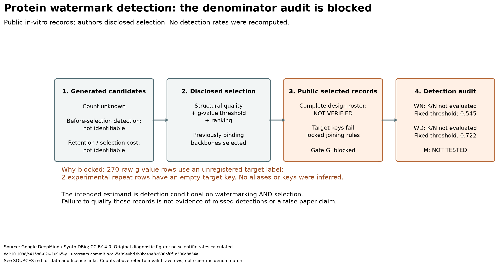

# 蛋白质也能带 AI 水印：‘100% 检出’到底覆盖谁？——DeepMind 论文公开体外验证集的条件分母复核

作者已披露筛选条件。本报告为已知结论的有限记录复核。
核心审计状态：未完成（G 阻断）；扩展分析状态：未执行；整项复核状态：部分完成（输入与失败审计完成）。
结论：公开记录尚不足以完成原集合的数字复核：冻结的靶标别名与空键规则阻断完整连接，M 未检验，不能判定通过；这不是发现漏检，也不据此否定论文的“100%”论断。筛选前检出率与原校准总体假阳性率仍不可由本集合识别。

## 来源与冻结清单

公开锁定提交链接、完整 SHA、首次公开 push 的 UTC 时间及证据：[锁定提交 8be7d0518127bd62b7f967ca75afb425763ab59a](https://github.com/empac666/ai4science-recheck-synthidbio/commit/8be7d0518127bd62b7f967ca75afb425763ab59a)，时间 `2026-10-09 03:04:51 UTC`；[平台活动接口](https://api.github.com/repos/empac666/ai4science-recheck-synthidbio/activity) 中活动 ID `45918352073` 为主分支从空引用创建至该根提交。仓库当前公开、用户确认此前已公开，匿名获取的锁定文件字节一致；[保存的证据](artifacts/public_lock.json) 不以 Git 日期替代发布时间。
协议/可行性文档/模板/代码哈希、软件版本、随机数配置及获取日期：协议 SHA-256 `ffc46de478a00e8eab77b0737d5e5337bc87a9b4fadff9ddb9efcb68f179f1c7`；可行性 SHA-256 `cafffb944e5333bfd72668b63213db7b259bd2a30e072b8666dfbd8761890aca`；正式获取前复制的模板 SHA-256 `a679df30c6a257f1b4581915677f9ae3af45c56defd4bc1afabe818b42c4ff58`。代码与配置于 `2026-10-09T04:21:50.436206+00:00`（第 8.134 分钟）冻结，首次真实输入执行前已提交 `57dfa66`；[逐文件代码哈希](artifacts/code_freeze.json)。软件：Python 3.13.5、NumPy 2.5.3、pandas 3.0.6、Matplotlib 3.11.2、Pillow 12.3.0；[精确依赖](requirements.lock)。固定随机配置为 PCG64(2026100901)、10000×3×15、int64、线性分位插值，本次未初始化或消费该生成器、未生成索引文件。获取日期 2026-10-09 UTC；[原始输入 URL 与逐项获取时间](artifacts/input_manifest.json)。7 项合成样例验收通过，覆盖拒绝重复表头冲突/键碰撞、跨靶标同名与技术重复分母、两检测阈值与三个敏感设置、KD 单位/缺失/六种删失符号、功能状态/识别界、配对抽样与熔断；[验收记录](artifacts/acceptance.json)。这不代表被阻断的真实数据科学分支已运行。

| 输入（四张 CSV、README、LICENSE 逐项） | 字节哈希 | 核验状态 |
|---|---|---|
| synthidbio_sequence/data/all_g_values.csv | `8421e8368cefbd27beb8d136b125f3c8a137f836ff57ab8adabd43364be93757` | 通过；64,488 字节 |
| synthidbio_sequence/data/VEGF-A/vegfa_data.csv | `321cc01da075c5f0b535a82f0d031b1bfaec1b88337f1541bc5ddd1be4103fe2` | 通过；114,207 字节 |
| synthidbio_sequence/data/PD_L1/pdl1_data.csv | `c8089b83259ac344805e724d4593884f4c67e9c617a55a2d2209d1838c4e0d2b` | 通过；108,131 字节 |
| synthidbio_sequence/data/SC2RBD/sc2rbd_data.csv | `e132509696cb528eb3e5bdf00d3e92b45d05df21b2ef736000fa4d67bae2e03f` | 通过；110,848 字节 |
| README.md | `861ed6bd339c7215f66d7c53dcb875566a12c39ba1648e80e29388b016a71da9` | 通过；24,147 字节 |
| LICENSE | `cfc7749b96f63bd31c3c42b5c471bf756814053e847c10f3eb003417bc523d30` | 通过；11,358 字节 |

参考附件状态与静态阈值出处：按协议跳过参考 PDF 重取；存档哈希 `6b9cadfdbc70e54eb711fc670139a1f7f61c4a79cafd965b6e0c2ba651887b04`。沿用补充表 S2 与图 S24/S25 的 WN=0.545、WD=0.722；图 S2 文字将失真设置与 0.649 并列的来源差异仍保留，不改选阈值。补充表 S3 不替换 S2。本次没有执行阈值比较。

## 资格与名册

| 检查（V/G/I/B/T 逐项） | 状态 | 原因或证据 |
|---|---|---|
| V | 通过 | 六份必需原始输入的长度及 SHA-256 全部匹配；PDF 为参考附件，未重复下载 |
| G | 不通过 | 270 行 g-value 使用未登记的 SARS-CoV-2；实验表同一 WN 设计的两条重复靶标为空，禁止补键 |
| I | 未完成 | 两条独立原始 CSV 解析路径均拒绝继续，未核验完整键集合、N/K/L 或敏感性；共同拒绝不构成 Gate I 通过 |
| B | 无资格 | 完整名册与 45 骨架配对未确认；实际逐重复单位与功能汇总未执行 |
| T | 通过（提前停止） | 资格阻断后提前收尾；未启动重采样或次级项目，未到任何时间熔断节点，未延长预算 |

| 靶标×设置 | 设计数 | 骨架数 | 仅左/仅右 | 重复/键碰撞 |
|---|---|---|---|---|
| VEGF-A × C | 74 个有效实验键；完整数未核验 | 15（仅有效键） | 0 / 0（仅有效键诊断） | 有效键中无重复；全名册被阻断 |
| VEGF-A × WN | 88 个有效实验键；完整数未核验 | 15（仅有效键） | 0 / 1（仅有效键诊断） | 有效键中无重复；全名册被阻断 |
| VEGF-A × WD | 89 个有效实验键；完整数未核验 | 15（仅有效键） | 0 / 0（仅有效键诊断） | 有效键中无重复；全名册被阻断 |
| PD-L1 × C | 74 个有效实验键；完整数未核验 | 15（仅有效键） | 0 / 0（仅有效键诊断） | 有效键中无重复；全名册被阻断 |
| PD-L1 × WN | 89 个有效实验键；完整数未核验 | 15（仅有效键） | 0 / 0（仅有效键诊断） | 有效键中无重复；全名册被阻断 |
| PD-L1 × WD | 89 个有效实验键；完整数未核验 | 15（仅有效键） | 0 / 0（仅有效键诊断） | 有效键中无重复；全名册被阻断 |
| SC2RBD × C | 74 个有效实验键；完整数未核验 | 15（仅有效键） | 74 / 0（仅有效键诊断） | 有效键中无重复；全名册被阻断 |
| SC2RBD × WN | 89 个有效实验键；完整数未核验 | 15（仅有效键） | 89 / 0（仅有效键诊断） | 有效键中无重复；全名册被阻断 |
| SC2RBD × WD | 89 个有效实验键；完整数未核验 | 15（仅有效键） | 89 / 0（仅有效键诊断） | 有效键中无重复；全名册被阻断 |

上述名册行仅定位问题，不能作为完整科学分母。原始 g-value 表 810 行，其中 `SARS-CoV-2` 270 行均不在冻结别名字典；实验表 `PDW_1080` 的两条 WN 重复（CSV 第 543、544 行，含表头）靶标为空。完整保留 [272 行阻断清单](artifacts/invalid_target_keys.csv)、[原值规整表](artifacts/key_normalization.csv) 和 [诊断外连接](artifacts/diagnostic_outer_join.csv)。仅有效键外连接（含对照）为匹配 539、仅实验侧 270、仅 g-value 侧 1；被拒行未删去或补键，另表列示。两种方法对这个诊断连接操作一致，不能替代 Gate I 的完整科学核对。[原失败记录](artifacts/failure_core.json)、[静态核验](artifacts/blocking_audit.json) 与 [名册诊断](artifacts/diagnostic_rosters.json) 均保留。

## 检测审计与必交图 1

| 六单元及两组总量 | N | K | L | 等阈值数 | g−τ 最小值及 5%/50%/95% 分位数 | 判定 |
|---|---|---|---|---|---|---|
| VEGF-A × WN | NA（未检验） | NA（未检验） | NA（未检验） | NA（未检验） | NA（未检验） | 未检验：G 阻断 |
| VEGF-A × WD | NA（未检验） | NA（未检验） | NA（未检验） | NA（未检验） | NA（未检验） | 未检验：G 阻断 |
| PD-L1 × WN | NA（未检验） | NA（未检验） | NA（未检验） | NA（未检验） | NA（未检验） | 未检验：G 阻断 |
| PD-L1 × WD | NA（未检验） | NA（未检验） | NA（未检验） | NA（未检验） | NA（未检验） | 未检验：G 阻断 |
| SC2RBD × WN | NA（未检验） | NA（未检验） | NA（未检验） | NA（未检验） | NA（未检验） | 未检验：G 阻断 |
| SC2RBD × WD | NA（未检验） | NA（未检验） | NA（未检验） | NA（未检验） | NA（未检验） | 未检验：G 阻断 |
| ALL × WN | NA（未检验） | NA（未检验） | NA（未检验） | NA（未检验） | NA（未检验） | 未检验：G 阻断 |
| ALL × WD | NA（未检验） | NA（未检验） | NA（未检验） | NA（未检验） | NA（未检验） | 未检验：G 阻断 |

| 六单元×三个敏感设置 | K/N | 分类变化数 | 零漏检是否改变 |
|---|---|---|---|
| VEGF-A × WN；g > τ | NA（未检验） | NA（未执行） | 未执行，不能判断是否敏感 |
| VEGF-A × WN；g ≥ τ−0.0005 | NA（未检验） | NA（未执行） | 未执行，不能判断是否敏感 |
| VEGF-A × WN；g ≥ τ+0.0005 | NA（未检验） | NA（未执行） | 未执行，不能判断是否敏感 |
| VEGF-A × WD；g > τ | NA（未检验） | NA（未执行） | 未执行，不能判断是否敏感 |
| VEGF-A × WD；g ≥ τ−0.0005 | NA（未检验） | NA（未执行） | 未执行，不能判断是否敏感 |
| VEGF-A × WD；g ≥ τ+0.0005 | NA（未检验） | NA（未执行） | 未执行，不能判断是否敏感 |
| PD-L1 × WN；g > τ | NA（未检验） | NA（未执行） | 未执行，不能判断是否敏感 |
| PD-L1 × WN；g ≥ τ−0.0005 | NA（未检验） | NA（未执行） | 未执行，不能判断是否敏感 |
| PD-L1 × WN；g ≥ τ+0.0005 | NA（未检验） | NA（未执行） | 未执行，不能判断是否敏感 |
| PD-L1 × WD；g > τ | NA（未检验） | NA（未执行） | 未执行，不能判断是否敏感 |
| PD-L1 × WD；g ≥ τ−0.0005 | NA（未检验） | NA（未执行） | 未执行，不能判断是否敏感 |
| PD-L1 × WD；g ≥ τ+0.0005 | NA（未检验） | NA（未执行） | 未执行，不能判断是否敏感 |
| SC2RBD × WN；g > τ | NA（未检验） | NA（未执行） | 未执行，不能判断是否敏感 |
| SC2RBD × WN；g ≥ τ−0.0005 | NA（未检验） | NA（未执行） | 未执行，不能判断是否敏感 |
| SC2RBD × WN；g ≥ τ+0.0005 | NA（未检验） | NA（未执行） | 未执行，不能判断是否敏感 |
| SC2RBD × WD；g > τ | NA（未检验） | NA（未执行） | 未执行，不能判断是否敏感 |
| SC2RBD × WD；g ≥ τ−0.0005 | NA（未检验） | NA（未执行） | 未执行，不能判断是否敏感 |
| SC2RBD × WD；g ≥ τ+0.0005 | NA（未检验） | NA（未执行） | 未执行，不能判断是否敏感 |

入选非水印组触发数/分母（两个分数分别列出）、阴性与亲本对照状态：C 的 WN 分数阈值触发数/分母为 NA（未执行），WD 分数阈值触发数/分母为 NA（未执行）。阴性与亲本对照仅登记原始类别，没有做结合汇总，不宣称与论文“未检出结合”一致。C 的这些比例即使可算也不等于校准总体 FPR。
图 1：[筛选分母与检出漏斗的阻断状态图](figures/figure1.png)（[SVG](figures/figure1.svg)）。作者已披露筛选条件；图中保留生成候选、筛选、公开入选、按阈值检出四阶段，完整分母未核验，WN/WD 的 K/N 均标未执行。它是失败审计图，不是已完成的科学检出漏斗。

筛选前检出率、候选保留率和筛选计算代价：本轮不可识别。

## 功能描述与未知量

单位假定及显式换算记录：VEGF-A/vegfa_data.csv、PD_L1/pdl1_data.csv、SC2RBD/sc2rbd_data.csv 三文件的无单位 `kd` 均预定按 mol/L、乘数 1 解释；这只是冻结假定，不能按数值猜单位。白名单显式单位换算及缺失/删失分派已用合成样例验收，实际记录因资格阻断未进入功能解析；逐重复单位来源、换算与冲突清单未生成，不能称单位资格通过。所有本可报告的功能数值均以单位假定正确为条件。

| 靶标×设置×阈值（18 行，设计数加权描述） | n | a | u | a/n | 识别界 | 结合/不结合/混合/不可定量/冲突记录 |
|---|---|---|---|---|---|---|
| VEGF-A × C × 1e-7 | NA（未核验） | NA（未核验） | NA（未核验） | 不可估计 | 不可估计 | 未执行；完整名册/配对被阻断 |
| VEGF-A × C × 1e-6 | NA（未核验） | NA（未核验） | NA（未核验） | 不可估计 | 不可估计 | 未执行；完整名册/配对被阻断 |
| VEGF-A × WN × 1e-7 | NA（未核验） | NA（未核验） | NA（未核验） | 不可估计 | 不可估计 | 未执行；完整名册/配对被阻断 |
| VEGF-A × WN × 1e-6 | NA（未核验） | NA（未核验） | NA（未核验） | 不可估计 | 不可估计 | 未执行；完整名册/配对被阻断 |
| VEGF-A × WD × 1e-7 | NA（未核验） | NA（未核验） | NA（未核验） | 不可估计 | 不可估计 | 未执行；完整名册/配对被阻断 |
| VEGF-A × WD × 1e-6 | NA（未核验） | NA（未核验） | NA（未核验） | 不可估计 | 不可估计 | 未执行；完整名册/配对被阻断 |
| PD-L1 × C × 1e-7 | NA（未核验） | NA（未核验） | NA（未核验） | 不可估计 | 不可估计 | 未执行；完整名册/配对被阻断 |
| PD-L1 × C × 1e-6 | NA（未核验） | NA（未核验） | NA（未核验） | 不可估计 | 不可估计 | 未执行；完整名册/配对被阻断 |
| PD-L1 × WN × 1e-7 | NA（未核验） | NA（未核验） | NA（未核验） | 不可估计 | 不可估计 | 未执行；完整名册/配对被阻断 |
| PD-L1 × WN × 1e-6 | NA（未核验） | NA（未核验） | NA（未核验） | 不可估计 | 不可估计 | 未执行；完整名册/配对被阻断 |
| PD-L1 × WD × 1e-7 | NA（未核验） | NA（未核验） | NA（未核验） | 不可估计 | 不可估计 | 未执行；完整名册/配对被阻断 |
| PD-L1 × WD × 1e-6 | NA（未核验） | NA（未核验） | NA（未核验） | 不可估计 | 不可估计 | 未执行；完整名册/配对被阻断 |
| SC2RBD × C × 1e-7 | NA（未核验） | NA（未核验） | NA（未核验） | 不可估计 | 不可估计 | 未执行；完整名册/配对被阻断 |
| SC2RBD × C × 1e-6 | NA（未核验） | NA（未核验） | NA（未核验） | 不可估计 | 不可估计 | 未执行；完整名册/配对被阻断 |
| SC2RBD × WN × 1e-7 | NA（未核验） | NA（未核验） | NA（未核验） | 不可估计 | 不可估计 | 未执行；完整名册/配对被阻断 |
| SC2RBD × WN × 1e-6 | NA（未核验） | NA（未核验） | NA（未核验） | 不可估计 | 不可估计 | 未执行；完整名册/配对被阻断 |
| SC2RBD × WD × 1e-7 | NA（未核验） | NA（未核验） | NA（未核验） | 不可估计 | 不可估计 | 未执行；完整名册/配对被阻断 |
| SC2RBD × WD × 1e-6 | NA（未核验） | NA（未核验） | NA（未核验） | 不可估计 | 不可估计 | 未执行；完整名册/配对被阻断 |

骨架明细：未生成 `functional_backbone_details.csv`：Gate B 未通过，完整名册与骨架配对未确认；实际行数与 SHA-256 均不适用，不用 270 行空壳或零计数冒充完成。
完整布局为 270 行；正文汇总不替代下表的骨架等权比较。
有限 KD 子集的描述及分母：未执行；可定量子集的分母及分布均未核验。

| 比较×阈值（四行） | 骨架等权点差 | 差异识别界 | 重采样标准差与区间 | 状态及原因 |
|---|---|---|---|---|
| WN−C × 1e-7 | 不可估计 | 不可估计 | 未执行；无区间 | Gate B 无资格，未启动计算 |
| WN−C × 1e-6 | 不可估计 | 不可估计 | 未执行；无区间 | Gate B 无资格，未启动计算 |
| WD−C × 1e-7 | 不可估计 | 不可估计 | 未执行；无区间 | Gate B 无资格，未启动计算 |
| WD−C × 1e-6 | 不可估计 | 不可估计 | 未执行；无区间 | Gate B 无资格，未启动计算 |

| 次级项目（功能权重、重复汇总、图 2 逐项） | 结果或链接 | 状态及原因 |
|---|---|---|
| 功能权重敏感性 | 未执行 | 资格阻断，重采样未执行，不比较微平均与骨架权重 |
| 重复汇总敏感性 | 未执行 | 资格阻断，未计算算术或几何均值结果 |
| 图 2 | 未执行 | 前置资格、重采样与两个次级敏感性未完成，按优先级取消 |

## 限制与停止记录

仅覆盖公开入选集合；不识别筛选前检出率或原校准总体 FPR。
功能描述受单位假定、未知量、已选骨架和温度差异限制，不作因果或等效结论。
第 40/60/75/80/90 分钟节点状态及实际停止时刻（不晚于第 120 分钟）、失败清单及修订记录：正式计时从 `2026-10-09T04:13:42.403231+00:00` 开始；首次真实输入尝试在第 8.140 分钟拒绝未知靶标。第 40/60/75/80/90 分钟节点均不适用（已因资格阻断提前结束）；没有启动重采样，不存在部分迭代区间。报告生成于 `2026-10-09T04:29:47.882199+00:00`，累计 16.091 分钟；实际收尾时刻见 [时间记录](artifacts/run_completion.json)，总墙钟严格小于 120 分钟。[执行事件](artifacts/timeline.jsonl)、[失败清单](artifacts/invalid_target_keys.csv)、[偏离与提前停止](DEVIATIONS.md)；未修订原协议或科学参数，未补做后续数值分析。
数据来源、固定提交、许可链接及处理变化：Google DeepMind / SynthIDBio 项目，[固定版数据说明](https://github.com/google-deepmind/synthidbio/blob/b2d65a39e0bd3b0bca9e82696bf6f1c306d8d34e/README.md#publication-data)，上游提交 `b2d65a39e0bd3b0bca9e82696bf6f1c306d8d34e`；数据 [CC BY 4.0](https://creativecommons.org/licenses/by/4.0/)。独立解析、键规整、失败定位和自制图，不分发原始序列、PDF 或论文原图；完整归属与处理变化见 [SOURCES.md](SOURCES.md)。本轮未重新计算分数或复现湿实验，协议与可行性文档保持冻结字节；所有传播稿只是草稿，未发送或发布。
